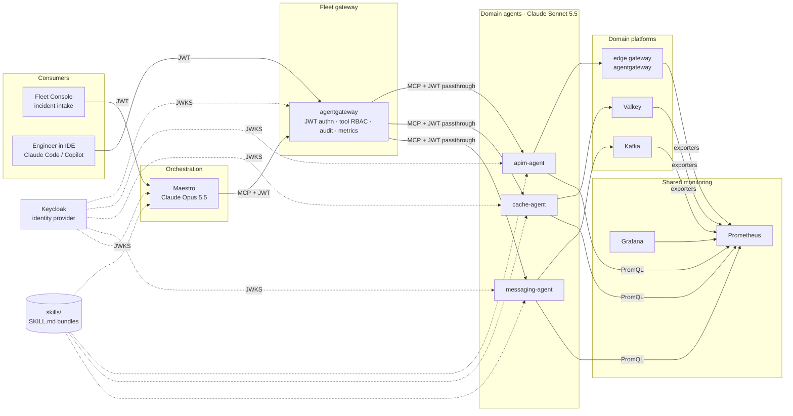

# Architecture

> Status: living document. Decisions are recorded in `docs/adr/`; this page explains how
> they fit together. Exact names, ports and schemas are in `contracts.md`.

## 1. The problem this architecture answers

Large enterprises run dozens of technology domains — API management, caching,
messaging, compute, network — each with its own platform team, its own tooling and its
own tribal knowledge about "what to look at when things go wrong". When a P1 lands,
responders spend the first hour finding the right people and the right dashboards.

Maestro replaces that hour with one question. A consumer asks the central
orchestrator; the orchestrator works out which domains are relevant, asks each
domain's agent in parallel, and posts a single consolidated assessment with confidence
scores and evidence. The human still decides the next step — the system shortens the
path to that decision from hours to minutes.

## 2. Layers

| Layer | Component | Open-source stand-in for | Why this one |
| --- | --- | --- | --- |
| Consumers | Fleet Console | ServiceNow / Teams bridge | A "Raise P1" button is all an executive demo needs ([ADR-0009](adr/0009-fleet-console-event-model.md)) |
| Consumers | Engineer in IDE | Copilot / Claude Code with MCP | Proves "same agents, same tools" — the IDE connects to the same gateway endpoint |
| Orchestration | Maestro | — | The agent of agents; Opus 5.5 at high effort ([ADR-0010](adr/0010-claude-models-and-effort.md)) |
| Fleet gateway | agentgateway | Kong AI Gateway / Konnect | Only OSS gateway that is MCP- *and* A2A-native with JWT + per-tool RBAC ([ADR-0003](adr/0003-agentgateway-as-fleet-gateway.md)) |
| Identity | Keycloak | Entra ID / Okta | Non-human identities as OAuth clients; roles in JWT claims ([ADR-0005](adr/0005-keycloak-identity-and-token-propagation.md)) |
| Domain: API management | second agentgateway as the *edge* | Kong Konnect | The platform a domain team would run; its config is a declarative file so change history is inspectable |
| Domain: cache | Valkey + redis_exporter | Redis Enterprise | Native Prometheus export; evictions and hit ratio are textbook signals |
| Domain: messaging | Kafka (KRaft) + kafka-exporter | Kafka / IBM MQ | Consumer lag is the signal every messaging SRE watches first |
| Shared monitoring | Prometheus + Grafana | Dynatrace / Splunk | The "common monitoring every domain already sends to"; agents must know its query language and dashboards ([ADR-0006](adr/0006-prometheus-grafana-shared-monitoring.md)) |
| Cognition | `skills/` | — | agentskills.io `SKILL.md` format, progressive disclosure ([ADR-0007](adr/0007-skills-md-as-agent-cognition.md)) |
| Platform | KIND on one VM | Enterprise Kubernetes | One `make up`, one `make down` ([ADR-0002](adr/0002-kind-on-a-single-vm.md)) |

## 3. A request, end to end

1. **Intake.** An operator presses *Raise P1 incident* in the Fleet Console (or an
   engineer asks Maestro from their IDE). The console obtains a JWT from Keycloak as
   its own non-human identity (`fleet-console`, client-credentials) and starts a
   *trace* — a correlation id that every downstream event carries.
2. **Orchestration.** Maestro receives the question with the caller's JWT. It
   connects to the fleet gateway's MCP endpoint *using the caller's token* and lists
   tools. The gateway only returns the tools the caller's roles allow — a caller
   without `domain:messaging` never sees the messaging agent. Maestro reasons about
   which domains are relevant and calls their `assess` tools in parallel.
3. **Gateway.** agentgateway validates the JWT against Keycloak's JWKS (issuer,
   audience, expiry), evaluates CEL authorization rules per tool and target, passes
   the token through to the chosen domain agent, and records metrics for Prometheus.
4. **Domain agent.** The agent verifies the JWT again (defence in depth, and so it
   can log *who* asked), loads its skills, and runs its own LLM loop with two kinds of
   tools: platform-native ones (Valkey `INFO`, Kafka consumer-group lag, the edge
   gateway's route config and change annotations) and the shared Prometheus. It
   returns a structured **finding** — implicated or not, confidence, evidence with
   deep links into Grafana, recommended actions.
5. **Assessment.** Maestro consolidates the findings into one **assessment**: which
   domains are implicated, which are cleared, which could not be consulted and why,
   and the recommended next step for the human. It posts the assessment back to the
   console (and returns it to the IDE).
6. **Visibility.** Every component emits events to the console's event hub as it
   works (`request.received`, `skills.loaded`, `evidence.gathered`,
   `finding.returned`, …). The console animates the flow on the topology and keeps a
   timeline. Executives watch the system think.

## 4. Identity and trust

- Every service that calls another presents a **JWT issued by Keycloak**. Services are
  OAuth clients with service accounts (non-human identities). Human engineers are
  realm users. Roles are realm roles carried in `realm_access.roles`.
- **Token propagation, not token minting.** Maestro forwards the *caller's* token to
  the domain agents. Authorization is therefore end-to-end per caller; Maestro cannot
  escalate. This keeps non-human identity management to one place (Keycloak) and one
  mechanism (JWT), which is the explicit reason we start with MCP rather than A2A.
- The gateway is the **policy enforcement point**: JWT validation, tool-level RBAC,
  CORS, metrics, audit logs. Domain agents are **secondary enforcement**: they verify
  the same token so a bypass of the gateway buys nothing.
- **A2A north star.** When agent cards and task lifecycles are needed, the same
  gateway routes A2A (`a2a: {}` policy) with the same JWT policies. See ADR-0004.

## 5. Cognition

Agents are plumbing; skills are knowledge. Each domain agent loads:

- its **domain skill** (`skills/<domain>-observability/SKILL.md`): the platform's
  failure modes, the exact metrics and PromQL to check, how to interpret them, what
  "implicated" means for this domain, the Grafana dashboard and panels to cite;
- the shared **monitoring skill** (`skills/prometheus-observability/SKILL.md`): label
  conventions, rate windows, how to turn a signal into evidence;
- on demand, files under each skill's `references/` via a `read_reference` tool —
  the progressive-disclosure pattern from the agentskills.io spec.

Maestro loads `skills/maestro-orchestration/SKILL.md`: triage heuristics, how to
decide which domains to consult, how to score and consolidate, how to write for a
human responder.

## 6. Shared monitoring

Prometheus (via kube-prometheus-stack) scrapes every platform's exporter, both
gateways' `/metrics`, the sample application and the agents themselves. Grafana is
provisioned with one dashboard per domain and a fleet overview. Domain agents cite
panels by deep link in their evidence so a responder can open exactly what the agent
looked at. The agents' skills document the panel-by-panel reading of each dashboard —
this is the "expert knowledge of exactly what to look for in the monitoring tool".

## 7. Fault injection

Each domain has a scenario that makes it the culprit, so the demo can show both an
implicated and a cleared verdict:

| Scenario | What changes | What the agents see |
| --- | --- | --- |
| `apim-bad-route` | Edge gateway route for `/api/members` is pointed at a backend that does not exist, annotated as change `CHG0123` | 5xx rate on the edge gateway; a recent change on that route; recommendation: roll back CHG0123 |
| `cache-pressure` | A filler job exceeds Valkey's `maxmemory` | Evictions climb, hit ratio collapses, portal-api latency rises |
| `messaging-lag` | The portal consumer is scaled to zero | Consumer-group lag grows without bound; producers are healthy |

Scenarios are applied and cleared from the console or `make scenario-<name>` /
`make scenario-clear`, and a `make reset` always returns to the clean state.

## 8. Repeatability

`scripts/up.sh` creates the KIND cluster if missing, installs or upgrades every Helm
release, builds images tagged by content hash and loads them into the cluster, waits
for readiness, and runs the smoke test. Every step is a no-op when already done.
`scripts/down.sh` deletes the cluster. Nothing depends on state outside the repo
except the secrets file and Docker's image cache.

## 9. What is deliberately out of scope

- Production hardening (TLS everywhere, HA Keycloak, persistent Prometheus). The
  design shows where each would go; the demo keeps the footprint inside 15 GiB.
- Automated remediation. Maestro recommends; humans act. This is a design choice,
  not a limitation — see ADR-0008.
- The compute and network domains. The extension path is documented in
  `adding-a-domain.md`.
